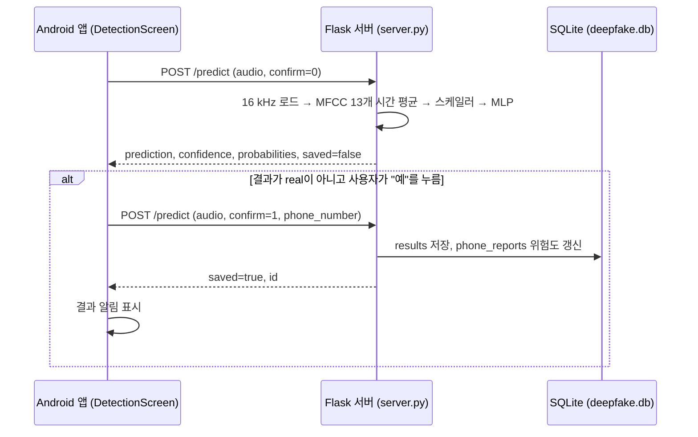

# 음성 계수 기반 딥페이크 검증 서비스

통화 녹음이나 음성 파일을 올리면 서버가 MFCC 특징으로 실제 음성(`real`)인지 합성 음성(`fake_2`, `tts`)인지 분류하고, Android 앱이 결과를 보여 주는 팀 프로젝트입니다. 사용자가 의심 통화로 확정한 결과만 서버 DB에 저장하고, 전화번호별 신고 횟수와 위험도를 누적합니다.

이 저장소는 [luna1114/deepfake-voice-detector](https://github.com/luna1114/deepfake-voice-detector)의 포크이며, 발표 자료 2개(`딥보이스 발표.pptx`, `음성 계수 기반 딥페이크 검증 서비스_포스터.pptx`)가 추가되어 있습니다.

> 같은 주제로 진행한 졸업논문 실험(다중 음향 특징 + BiLSTM/Transformer 비교)은 [Capstone-Project](https://github.com/Roooselina/Capstone-Project)에 있습니다. 이 서비스의 서버 모델은 그것과 다른 MFCC 13차원 기반 3클래스 분류기입니다.

## 현재 상태

| 구분 | 내용 |
|---|---|
| 구현됨 | Flask 서버 `/health`, `/predict`, SQLite 저장, 전화번호별 위험도 누적(EMA), Android 앱(Jetpack Compose)의 녹음·파일 선택·업로드·결과 표시·확정 대화상자·알림 |
| 실행 확인 | 이번 문서 정리에서는 서버와 앱을 실행하지 않았습니다. Android SDK가 없는 환경이었습니다 |
| 알려진 불일치 | `backend/requirements.txt`(FastAPI, uvicorn, SQLAlchemy)와 `backend/run.py`(`app.main:app` 실행)는 실제 서버 코드 `backend/server.py`(Flask)와 맞지 않습니다. 아래 [서버 실행](#서버-실행)의 패키지 목록은 `server.py`의 import 기준입니다 |
| 모델 성능 | 이 저장소에는 서버 모델의 학습 코드와 평가 결과가 없습니다 |

## 처리 흐름



## API

`POST /predict` (multipart/form-data)

| 필드 | 필수 | 설명 |
|---|---|---|
| `audio` | 예 | WAV 또는 MP3 파일 |
| `confirm` | 아니요 | `1`, `true`, `yes`면 저장. 없으면 판정만 하고 저장하지 않음 |
| `phone_number` | 아니요 | 저장할 때 연결할 번호. 없으면 `data.json`의 번호 목록에서 순서대로 배정 |

응답 형식(`server.py` 기준, 값은 예시가 아니라 필드 설명입니다):

```json
{
  "id": "저장된 행 id 또는 null",
  "saved": "true | false",
  "prediction": "real | fake_2 | tts",
  "confidence": "가장 높은 클래스 확률",
  "probabilities": { "real": 0.0, "fake_2": 0.0, "tts": 0.0 },
  "phone_number": "저장 시 연결된 번호 또는 null"
}
```

오류: 파일 없음·빈 파일은 400, 지원하지 않는 형식은 415, 그 밖의 예외는 500.

위험도 갱신(`upsert_phone_report`): `alpha = clamp(0.3 + 0.7 × (confidence − 0.5))`, `risk = alpha × confidence + (1 − alpha) × 이전 risk`.

## 디렉터리

| 경로 | 내용 |
|---|---|
| `backend/server.py` | Flask 서버, 모델 정의(`AttentionAudioClassifier`: MLP + SE 블록), 추론, DB 저장 |
| `backend/best_asvspoof_model_cuda.pt`, `scaler_asvspoof.pkl` | 서버가 읽는 가중치(약 1.8 MB)와 MFCC 스케일러 |
| `backend/manage_db.py`, `upload_json.py` | DB 관리, 더미 데이터 생성, JSON 번호 목록 업로드 스크립트 |
| `backend/data.json`, `phone_cursor.txt`, `deepfake.db` | 번호 목록, 배정 위치, 저장된 결과 DB |
| `MainActivity/` | Android 앱 (Kotlin, Compose, Retrofit/OkHttp, minSdk 24, targetSdk 34) |
| `MyApplication/` | Android Studio 기본 템플릿 프로젝트 (사용되지 않는 것으로 보임) |

## 서버 실행

검증하지 않은 절차입니다.

```bash
cd backend
pip install flask flask-cors torch librosa soundfile joblib numpy scikit-learn
python server.py        # 0.0.0.0:5000, 시작 시 deepfake.db 테이블 생성
curl http://127.0.0.1:5000/health
curl -F "audio=@sample.wav" http://127.0.0.1:5000/predict
```

`scaler_asvspoof.pkl`은 scikit-learn 객체라 저장할 때와 다른 버전에서는 경고나 오류가 날 수 있습니다. 저장 당시 버전은 기록되어 있지 않습니다.

## 앱 실행

`MainActivity/` 폴더를 Android Studio로 엽니다. 서버 주소는 `network/ApiClient.kt`의 `BASE_URL`에 사설 IP와 포트 5000으로 고정되어 있으므로, 서버를 띄운 PC의 주소로 바꿔야 합니다. HTTP(비 TLS) 통신을 사용합니다.

## 팀과 기여

| 항목 | 내용 |
|---|---|
| 팀 | 2명 (이은정, 박가영) |
| 기간 | 약 2개월 반 |
| 이은정 담당 | 웹–AI 연결 부분을 제외한 개발 |

담당 범위는 팀 내 분담 기준(작성자 확인)입니다. 코드는 원본 저장소의 첫 커밋(2025-11-10, luna1114)에 한꺼번에 올라왔기 때문에 커밋 기록으로는 분담을 구분할 수 없고, 이 포크에서 추가된 커밋은 발표 자료 2개입니다.

## 한계

- 서버 모델은 MFCC 13개를 시간축으로 평균한 벡터 하나만 보므로 시간에 따른 변화는 반영하지 않습니다.
- `fake_2`, `tts` 클래스의 학습 데이터 정의와 평가 결과가 저장소에 없습니다.
- 서버에 인증이 없고 `debug=False`로 `0.0.0.0`에 열립니다. 로컬 시연용 구성입니다.
- 실행 환경 문서(`requirements.txt`, `run.py`)가 실제 코드와 맞지 않습니다.

## 라이선스

라이선스가 지정되지 않았습니다.
